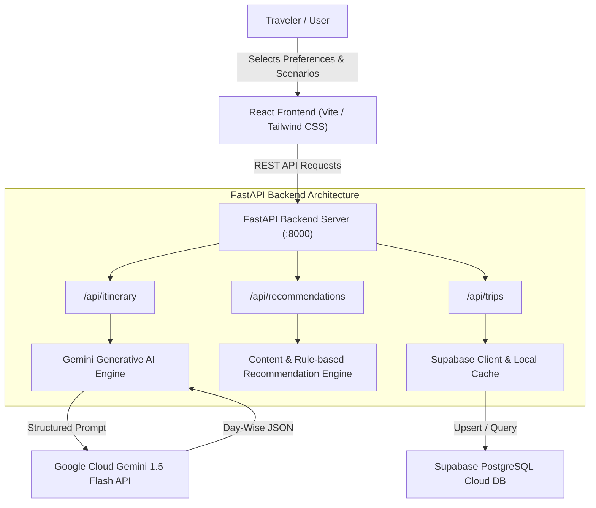

# WanderWise AI - Personalized Travel Itinerary Planner 🌍✈️

[](https://fastapi.tiangolo.com)
[](https://react.dev)
[](https://ai.google.dev/)
[](https://supabase.com)
[](https://tailwindcss.com)
[](LICENSE)

An intelligent full-stack web application that simplifies travel planning through intelligent automation, prompt engineering, and generative AI. Built with a **React** frontend, **FastAPI** backend, and **Supabase** database integration, it generates customized day-by-day itineraries based on user preferences, budget constraints, travel styles, and geographic clustering.

---

## 🌟 Key Features

- **Prompt Engineering & Generative AI**: Powered by Google Gemini (`gemini-1.5-flash`) with structured JSON schema enforcement and zero-hallucination route planning.
- **Smart Trip Builder**: Multi-step preference profiling covering destination, dates, budget tiers (Budget $, Moderate $$, Luxury $$$), pacing (Relaxed, Balanced, Fast-Paced), travel styles, and dietary restrictions.
- **3 Core Scenario Presets**:
  1. **Solo Traveler Weekend Getaway**: Time-optimized routes, walkable sightseeing clusters, solo-friendly dining, safe navigation.
  2. **Romantic Couple Vacation**: Relaxed pacing, scenic sunset viewpoints, boutique stays, curated romantic dinners.
  3. **Small Group Multi-Day Coordination**: Group size scaling, balanced activity interests (adventure vs. culture), buffer times, and split-budget per-person calculations.
- **Dynamic Day-by-Day View**: Morning, afternoon, and evening slots with estimated costs, transit durations, and insider tips.
- **Single-Day Regeneration**: Modify and regenerate individual days with custom prompt feedback without changing the rest of the trip.
- **Real-Time Budget Tracker**: Category breakdowns (Attractions, Dining, Local Transit) and group cost splits per traveler.
- **Geographic Route & Pin Visualizer**: Visual timeline of stops and transit legs for every day.
- **Supabase Persistence & Offline Resiliency**: Fully functional with remote Supabase PostgreSQL or local fallback storage.
- **Export & Share**: Generate print-ready travel handbooks (PDF) and structured JSON exports.

---

## 🏗️ System Architecture



---

## 📁 Project Directory Structure

```text
travel-itinerary-planner/
├── backend/
│   ├── app/
│   │   ├── config.py              # Environment settings & CORS
│   │   ├── main.py                # FastAPI entry point & health check
│   │   ├── models/
│   │   │   └── schemas.py         # Pydantic schemas (Trip, Activity, DayPlan, Itinerary)
│   │   ├── routers/
│   │   │   ├── itinerary.py       # Generate & regenerate day endpoints
│   │   │   ├── recommendations.py # AI recommendations endpoint
│   │   │   └── trips.py           # Saved trips CRUD
│   │   └── services/
│   │       ├── gemini_service.py  # Google Gemini LLM prompt engineering & fallback
│   │       ├── recommendation_engine.py # Interest & travel style scoring
│   │       └── supabase_service.py # PostgreSQL DB sync & local memory cache
│   ├── tests/
│   │   └── test_api.py            # Pytest test suite
│   ├── requirements.txt           # Python dependencies
│   ├── run.py                     # Uvicorn startup script
│   └── .env.example
├── frontend/
│   ├── src/
│   │   ├── components/
│   │   │   ├── Navbar.jsx
│   │   │   ├── ScenarioPresets.jsx
│   │   │   ├── TripBuilder.jsx
│   │   │   ├── ItineraryView.jsx
│   │   │   ├── DayView.jsx
│   │   │   ├── ActivityCard.jsx
│   │   │   ├── BudgetTracker.jsx
│   │   │   ├── MapView.jsx
│   │   │   ├── RecommendationsPanel.jsx
│   │   │   └── ExportModal.jsx
│   │   ├── services/
│   │   │   ├── api.js             # API connector with client-side fallback
│   │   │   └── mockData.js        # Seed datasets for all 3 scenarios
│   │   ├── App.jsx
│   │   ├── main.jsx
│   │   └── index.css
│   ├── package.json
│   ├── vite.config.js
│   └── tailwind.config.js
├── supabase/
│   ├── schema.sql                 # Complete PostgreSQL DDL & RLS policies
│   └── seed.sql                   # Preloaded sample data for all 3 scenarios
├── standalone.html                # Zero-dependency browser preview file
├── docker-compose.yml             # Container orchestration
├── Dockerfile.backend             # Production backend image
├── Dockerfile.frontend            # Nginx frontend image
├── SUBMISSION_GUIDE.md            # Mentor review & deployment guide
└── README.md
```

---

## 🚀 Quickstart Guide

### Option 1: Instant Standalone Preview (Zero Dependencies)
Double-click `standalone.html` in your file explorer or open it in any modern browser. You can immediately test:
- Preloading all 3 official scenarios
- Creating custom trips to any global city
- Interactive activity completion checkboxes
- Single-day AI rewriting with custom prompts
- Budget tracking and per-person cost calculations
- Exporting to PDF and copying JSON data

### Option 2: Running with Node.js & React
```bash
cd frontend
npm install
npm run dev
```
Open [http://localhost:5173](http://localhost:5173).

### Option 3: Running FastAPI Backend (Python)
```bash
cd backend
pip install -r requirements.txt
cp .env.example .env
# Edit .env with your GEMINI_API_KEY and SUPABASE credentials
python run.py
```
- API Docs: [http://localhost:8000/docs](http://localhost:8000/docs)
- Health Check: [http://localhost:8000/api/health](http://localhost:8000/api/health)

### Option 4: Docker Compose
```bash
docker-compose up --build
```
- Frontend: [http://localhost:3000](http://localhost:3000)
- Backend API: [http://localhost:8000](http://localhost:8000)

---

## 🗄️ Supabase Setup (Epic 2)

1. Open your project on [Supabase.com](https://supabase.com).
2. Navigate to **SQL Editor**.
3. Copy and run the contents of `supabase/schema.sql`.
4. Copy and run the contents of `supabase/seed.sql` to preload the 3 evaluation trips.
5. Add your `SUPABASE_URL` and `SUPABASE_KEY` into `backend/.env`.

---

## 🧪 Testing (Epic 7)

To run the automated backend test suite:
```bash
cd backend
pytest tests/test_api.py -v
```

---

## 📋 Evaluation Epics Progress

| Epic | Description | Status |
| :--- | :--- | :--- |
| **Epic 1** | Vibe Coding Environment Setup | ✅ Complete |
| **Epic 2** | Supabase Database Setup & Schema | ✅ Complete |
| **Epic 3** | Preference Collection & Recommendation Engine | ✅ Complete |
| **Epic 4** | Itinerary Generation & Personalization (Gemini AI) | ✅ Complete |
| **Epic 5** | Productization & Interactive Dashboard | ✅ Complete |
| **Epic 6** | Deployment Configurations (Docker / Vercel) | ✅ Complete |
| **Epic 7** | Final Testing & Submission Guide | ✅ Complete |
